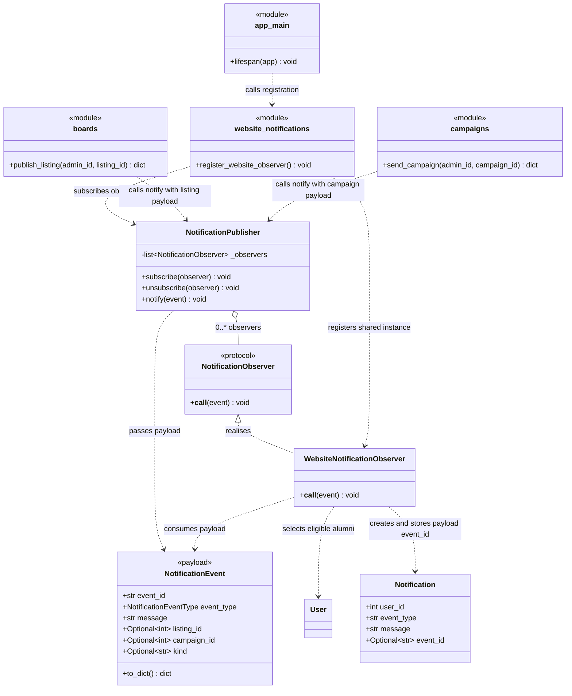

# Observer integration handoff (task #6.4)

This document describes the **current merged implementation** at `ec6a278` (latest merge into `main`). It is documentation only: no production behaviour, dependencies or teammate-owned code were changed. It separates implemented behaviour from requirements that are still open.

## 1. Verification of #6.1, #6.2 and #6.3

All three implementation tasks are present in the latest merged code. Before this document, the missing item was this consolidated handoff/UML mapping.

| Task | Status | Merged evidence |
| --- | --- | --- |
| #6.1 Observer contract and publisher | **Present** | `22758cb` added `app/services/observer.py` (`NotificationEvent`, `NotificationObserver`, `NotificationPublisher`, `notification_publisher`) and `tests/test_observer.py`; merged in `bc50fe8`. |
| #6.2 In-app website observer with persistent deduplication | **Present** | `6d1214f` added `app/services/website_notifications.py`, `Notification.event_id`, the unique index, schema migration and registration in `app/main.py`; merged in `2fcd45b`. |
| #6.3 Observer integration and failure isolation | **Present** | `e290364` wired listing publication (merged in `c3d532a`), `d8752e0` wired campaign sending (merged in `b015e4d`), and `6b0b3aa` added per-observer `try/except` logging (merged in `5f1d8ce`). Tests are in `tests/test_publish_observer.py`, `tests/test_campaigns.py`, `tests/test_observer.py` and `tests/test_website_notifications.py`. |

### Implementation ownership and snapshot boundary

Implementation ownership from commit authors:

| Contribution | Owner | Evidence |
| --- | --- | --- |
| Listing emitter (`app/services/boards.py::publish_listing`) | **Kyle** | `e290364` |
| Campaign emitter (`app/services/campaigns.py::send_campaign`) | **Sean Caruth** | `d8752e0` |
| Shared Observer contract/publisher, website observer, persistent duplicate prevention, failure isolation and integration tests | **Micah** | `22758cb`, `6d1214f`, `6b0b3aa` |

Micah's `c3d532a` and `b015e4d` commits are merge commits for Kyle's and Sean's work; they are not implementation authorship.

This document remains pinned to `ec6a278`. Sean's proposed **per-call dispatch-result interface** is pending and **outside that snapshot**. Repository-wide searches of the working tree and all commit refs found no dispatch-result type, API, test or documentation for it; `NotificationPublisher.notify()` returns `None` and does not report per-observer results. Discussion of the proposal is not implementation evidence.

Note: the old dict-based registry in `app/services/notifications.py` still exists, but it is **not** used by the new publish/campaign fan-out. Its `inbox()` is still the inbox read helper; `seed(reset=True)` calls its legacy `clear_observers()`. No code calls its `notify()`, `subscribe()` or `ensure_default_observers()` in the current merge.

## 2. Actual classes, methods and file paths

| Concern | File | Actual API |
| --- | --- | --- |
| Event contract | `app/services/observer.py` | `LISTING_PUBLISHED = "listing.published"`, `CAMPAIGN_SENT = "campaign.sent"`, `NotificationEventType`, frozen dataclass `NotificationEvent` with `event_type`, `listing_id`, `campaign_id`, `message`, `event_id`, `kind` and `to_dict()`. `__post_init__` validates the type/identifier combination. |
| Publisher (subject) | `app/services/observer.py` | `NotificationPublisher` with `subscribe(observer)`, `unsubscribe(observer)`, `notify(event)`; shared module-level instance `notification_publisher`. `subscribe()` ignores an observer already present. `notify()` iterates a snapshot (`tuple(self._observers)`). |
| Observer interface | `app/services/observer.py` | `@runtime_checkable class NotificationObserver(Protocol)` with `__call__(self, event: NotificationEvent) -> None`. |
| Website observer | `app/services/website_notifications.py` | `WebsiteNotificationObserver.__call__(event)`, shared module-level instance `website_notification_observer`, `register_website_observer()`, plus `_is_duplicate_notification(exc)` for index-specific `IntegrityError` handling. |
| Application registration | `app/main.py` | `lifespan(app)` calls `register_website_observer()` before `seed(reset=False)`. The publisher is in-memory and process-local; registration happens once per process lifespan. |
| Notification persistence | `app/models/notification.py` | `Notification` with `event_id` and unique `Index("uq_notification_user_event", "user_id", "event_id", unique=True)`. |
| Schema migration | `app/database.py` | `_ensure_notification_event_id_column()` adds `event_id` and the unique index to existing databases; called from `create_db_and_tables()`. |
| Inbox read | `app/services/notifications.py`, `app/routers/board.py` | `notifications.inbox(user_id)` is exposed as `GET /api/notifications` (`my_notifications`). |

The website observer selects `User.role == "alumni" AND User.email_verified == 1`, then rechecks with `require_verified_alumni(public_user(user)) is None` from `app/services/accounts.py`. That recheck also enforces the approved UWI domain. It writes one `Notification` per recipient in its own transaction.

## 3. How publication and campaign sending reach the inbox

### Listing publication

1. `POST /api/admin/listings/{listing_id}/publish` in `app/routers/board.py::publish`.
2. `app/services/boards.py::publish_listing` checks admin status and pending status, commits `status="published"`, then calls `notification_publisher.notify(...)` once with:
   `NotificationEvent(event_type=LISTING_PUBLISHED, listing_id=..., kind=<job|event>, message="New <kind> on the board: <title>")`.
3. `NotificationPublisher.notify()` calls every subscribed observer.
4. `WebsiteNotificationObserver.__call__` selects eligible verified alumni and inserts `Notification` rows carrying `event_id`.
5. The next `GET /api/notifications` returns those rows via `notifications.inbox()`.

Submitting a listing and rejecting a listing emit **no** event. A repeated publish attempt returns 400 and emits no extra event.

### Campaign sending

1. `POST /api/admin/campaigns/{campaign_id}/send` in `app/routers/board.py::send_campaign`.
2. `app/services/campaigns.py::send_campaign` checks admin status, marks the campaign `sent`, commits, then calls `notification_publisher.notify(...)` once with:
   `NotificationEvent(event_type=CAMPAIGN_SENT, campaign_id=..., message=f"Campaign: {subject} - {body[:120]}")`.
3. Steps 3–5 are the same as listing publication. The event reaches the **website inbox**; no email is sent.

Creating a draft or listing campaigns emits no event.

## 4. Runnable examples

Run these from the repository root with the project virtual environment active. They use a **local** `NotificationPublisher`, so they do not change application data. To verify the persisted inbox path, use the tests in section 6.

### 4.1 Build and inspect events with the existing contract

```python
from app.services.observer import (
    CAMPAIGN_SENT,
    LISTING_PUBLISHED,
    NotificationEvent,
)

listing = NotificationEvent(
    LISTING_PUBLISHED,
    listing_id=42,
    kind="job",
    message="New job on the board: Tutor",
    event_id="handoff-listing-42",
)
campaign = NotificationEvent(
    CAMPAIGN_SENT,
    campaign_id=7,
    message="Campaign: Workshop - Join us",
    event_id="handoff-campaign-7",
)

print(listing.to_dict())
print(campaign.to_dict())

# Replay: reuse the SAME event_id and payload for the same logical event.
replay = NotificationEvent(
    LISTING_PUBLISHED,
    listing_id=42,
    kind=listing.kind,
    message="New job on the board: Tutor",
    event_id=listing.event_id,
)
assert replay.event_id == listing.event_id
assert replay == listing
```

Observed dictionaries:

```text
{'event_id': 'handoff-listing-42', 'event_type': 'listing.published', 'message': 'New job on the board: Tutor', 'listing_id': 42, 'kind': 'job'}
{'event_id': 'handoff-campaign-7', 'event_type': 'campaign.sent', 'message': 'Campaign: Workshop - Join us', 'campaign_id': 7}
```

### 4.2 Notify observers and continue past a failing observer

```python
from app.services.observer import (
    LISTING_PUBLISHED,
    NotificationEvent,
    NotificationPublisher,
)


class CollectingObserver:
    def __init__(self):
        self.events = []

    def __call__(self, event):
        self.events.append(event.to_dict())


def failing_observer(event):
    raise RuntimeError("channel unavailable")


publisher = NotificationPublisher()
collector = CollectingObserver()
publisher.subscribe(failing_observer)
publisher.subscribe(collector)

event = NotificationEvent(
    LISTING_PUBLISHED,
    listing_id=42,
    message="New job on the board: Tutor",
    event_id="handoff-listing-42",
)
publisher.notify(event)

print(collector.events)
```

Observed behaviour: `app.services.observer` logs an `ERROR` with the observer identity, `event_type=listing.published` and `event_id=handoff-listing-42` (with traceback). After that failure, `collector.events` still contains the event. The publisher does not remove the failing observer, so it remains subscribed for later events.

## 5. Event ID and failure rules

### Event IDs and duplicate prevention

- A new `NotificationEvent` gets `event_id=str(uuid4())` by default.
- **Replaying** an event means notifying again with the **same `event_id`**. Pass it explicitly to the constructor, as in section 4.1. Generating a new ID creates a new logical event and therefore new notifications.
- Duplicate prevention is **per recipient and per event ID**, enforced by the unique index `(user_id, event_id)` in `app/models/notification.py`.
- `WebsiteNotificationObserver` catches only a matching `(user_id, event_id)` conflict (PostgreSQL SQLSTATE `23505` plus index `uq_notification_user_event`, or the specific SQLite message) and skips that recipient. Other integrity errors are re-raised.
- One duplicate recipient does not block delivery to the rest of the audience.

### Failure behaviour

- `NotificationPublisher.notify()` wraps each observer call in `try/except Exception`, logs via `logger.exception(...)`, and continues with the next observer.
- A failing observer is **not** removed and will be called for future events.
- There is **no automatic retry, queue, outbox, backoff or guaranteed delivery**. `notify()` returns `None` and does not report failures to the caller.
- The website observer commits per recipient, so a committed row is not rolled back by a later recipient's failure. However, an observer failure after the listing/campaign status commit does not undo that status change.
- The publisher uses an in-memory, process-local shared module-level instance. Subscriptions are process-local and lost on restart. Events are dispatched synchronously; the publisher does not store or queue them for later delivery. Persisted `Notification` records remain in the database.

## 6. Test commands and actual results

Environment used: Windows, Python `3.13.14`, pytest `9.1.1`, repository root. Results below were recorded for the `ec6a278` implementation snapshot and are not rerun for documentation-only wording changes. All commands were run sequentially; no parallel test plugin was used.

| Command | Actual result |
| --- | --- |
| `python -m pytest tests -q` | `135 passed, 1 warning in 39.56s` (recorded for the `ec6a278` snapshot) |
| `python -m pytest tests/test_observer.py tests/test_website_notifications.py tests/test_publish_observer.py tests/test_campaigns.py -q` | `48 passed, 1 warning in 3.91s` |
| `python -m pytest tests/test_observer.py -q` | `17 passed in 0.03s` |
| `python -m pytest tests/test_website_notifications.py -q` | `17 passed in 0.51s` |
| `python -m pytest tests/test_publish_observer.py -q` | `10 passed, 1 warning in 3.31s` |
| `python -m pytest tests/test_campaigns.py -q` | `4 passed in 0.12s` |

The single warning is the pre-existing `StarletteDeprecationWarning` from `fastapi/testclient.py` about `httpx` with `starlette.testclient` (the environment also has `httpx2`). There were no failures or errors.

Tests that directly evidence this document:

- Contract/subscription/failure isolation: `tests/test_observer.py` (`test_notify_dispatches_one_stable_event_to_every_observer`, `test_failing_observer_does_not_block_other_observers`, `test_two_failing_observers_followed_by_healthy_observer`, `test_failing_observer_remains_subscribed_for_future_events`).
- Persistence, replay and audience: `tests/test_website_notifications.py` (`test_observer_selects_only_eligible_alumni`, `test_reprocessing_same_event_does_not_duplicate_records`, `test_duplicate_conflict_does_not_block_other_recipients`, `test_application_initialization_registers_observer`, `test_publish_listing_triggers_website_observer`, `test_send_campaign_triggers_website_observer`).
- End-to-end API emission: `tests/test_publish_observer.py` and campaign cases in `tests/test_campaigns.py`.

## 7. UML mapping for Sawdah

Use this mapping for the class/relationship update. `WebsiteNotificationObserver` is the only concrete observer currently registered.

| UML element | Source | Relationships to draw |
| --- | --- | --- |
| `NotificationEvent` (`<<payload>>`, frozen dataclass) | `app/services/observer.py` | Payload passed by `NotificationPublisher.notify()` to `WebsiteNotificationObserver.__call__()`; it is **not** a persisted event entity or table. Required `event_id`, `event_type`, `message`; optional `listing_id`, `campaign_id`, `kind`. Operation `to_dict()`. |
| `NotificationObserver` (`<<protocol>>`, observer interface) | `app/services/observer.py` | `NotificationPublisher` has `0..*` of it; `WebsiteNotificationObserver` realises it. Operation `__call__(event)`. |
| `NotificationPublisher` (`<<subject>>`) | `app/services/observer.py` | Uses `NotificationObserver`; passes `NotificationEvent` as a payload. Shared module-level instance `notification_publisher`. Operations `subscribe`, `unsubscribe`, `notify`. |
| `WebsiteNotificationObserver` (`<<concrete observer>>`) | `app/services/website_notifications.py` | Realises `NotificationObserver`. Reads `User`, creates `Notification`. Shared module-level instance `website_notification_observer`. |
| `register_website_observer()` | `app/services/website_notifications.py` | Called by `app.main.lifespan`; subscribes the shared module-level instance to `notification_publisher`. |
| `app.services.boards` module, function `publish_listing()` | Function in `app/services/boards.py` | Constructs a `listing.published` `NotificationEvent` payload and calls `notification_publisher.notify()`. Model as a module containing a function, not a class. |
| `app.services.campaigns` module, function `send_campaign()` | Function in `app/services/campaigns.py` | Constructs a `campaign.sent` `NotificationEvent` payload and calls `notification_publisher.notify()`. Model as a module containing a function, not a class. |
| `Notification` | `app/models/notification.py` | Created by `WebsiteNotificationObserver`; stored `event_id` is nullable `str` (default `None`, `exclude=True`) and copies the payload's ID. Unique index on `(user_id, event_id)`. `user_id` is a logical reference to `User.id`; no SQL foreign key and no persisted event entity. Inbox responses omit `event_id`. |
| `notifications.inbox()` / `my_notifications()` | `app/services/notifications.py` / `app/routers/board.py` | Reads `Notification` for `GET /api/notifications`. |

Suggested Mermaid class diagram:



## 8. Current status of the four specifically requested capabilities

Do **not** claim these work based on this merge; the code and tests do not establish them.

| Capability | Status | Evidence in current code/tests |
| --- | --- | --- |
| Email delivery | **Not implemented** | `app/services/campaigns.py::send_campaign` only updates `Campaign` and emits a `NotificationEvent`; no SMTP/mailer exists in `requirements.txt` or the codebase. `app/services/accounts.py::verify_email` is explicitly a demo stub with no token mailer. Tests only assert in-app notification rows. |
| Immediate browser updates | **Not implemented** | The only notification read path is on-demand `GET /api/notifications`; there is no WebSocket, SSE, polling or auto-refresh for the inbox. Front-end `fetch` calls in `app/templates/alumni_dashboard.html` concern listing edit/deletion requests, not notifications. |
| Revoked-account exclusion | **Not implemented / not verifiable** | `app/models/user.py` has no revoked/suspended field. The observer filters only `role`, `email_verified` and (via `require_verified_alumni`) the UWI domain. Its module docstring says exclusion is pending the agreed account model. No test covers a revoked account. |
| Academic relevance matching | **Not implemented** | `app/services/website_notifications.py` says academic relevance matching is not implemented. No academic/program/interest fields or matching logic exist, and the `kind` metadata on listing events is not used for targeting. All eligible verified alumni receive every event. |

## 9. Remaining requirements (not implemented here)

These are open work, not descriptions of current behaviour:

1. Real email delivery for campaigns and verification tokens, with delivery status/failure handling.
2. Immediate browser delivery or refresh for the website inbox (WebSocket/SSE/polling), as requested by the stakeholder.
3. An agreed revoked/suspended account model and explicit exclusion of those accounts from all notification audiences.
4. Academic relevance data and matching rules (for example faculty/program/interest filters) before claiming targeted delivery.
5. Durable delivery semantics (outbox/queue/retry) if guaranteed delivery is required; the current publisher is best-effort and in-process.
6. Sawdah's UML diagram update from the mapping in section 7 (documentation handoff; no diagram file is changed here).
7. Sean's proposed per-call dispatch-result interface is pending and outside the `ec6a278` snapshot; no such API exists in the repository.
